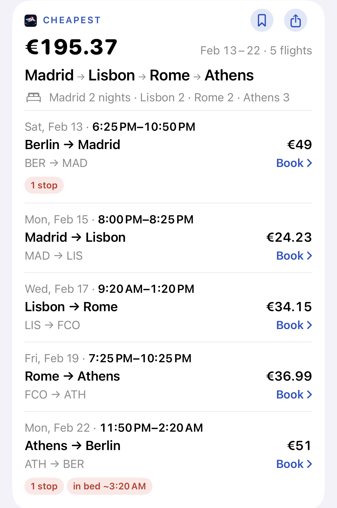
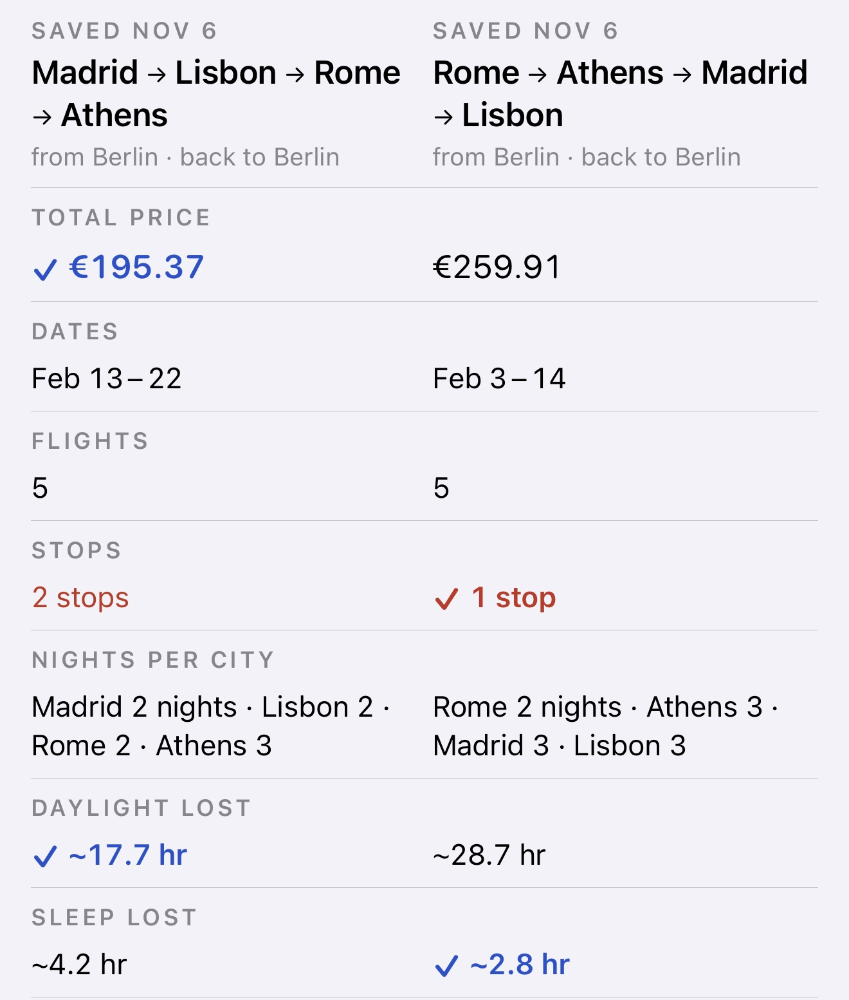

# I tested whether city order changes flight prices. Dates got in the way.

*Yes, the order can change the price, but the dates usually move with it. Eight real searches, four cities each.*

I built a trip planner because of a visa. I had one month and a long list of places I'd never seen, and I wanted to fit in as many as I could without overspending.

Budget airlines in Europe sell one-way fares, so each flight has its own price on each day. Change the order of your cities and you're buying different flights on different days. Four cities with the same start and finish can be visited in 24 orders, and most search forms ask you to pick one before they show a single fare.

Everyone says the order matters, so I tested it.

## The test

On 6 November 2026 I ran eight searches on ffly's free web search, ranked by Cheapest. Each was a round trip from one European city through four others, in February 2027, with two or three nights per city. Together they compared 3,261 fares.

Between the cheapest and dearest orders shown, the gap ran from 14% to 65%. The median was 30%, or about €62.

Berlin had the widest gap. Madrid, Lisbon, Rome and Athens came to €195, while Lisbon, Athens, Madrid and Rome came to €322.

*The cheapest route shown from the Berlin search, replayed in the app's Pro view. Search run on 6 November 2026, and some fares were last seen a few days earlier. Flights only, one adult. It isn't a price you'll get.*

## The catch

Those two Berlin routes left ten days apart, with different nights and connections. Across all eight searches, the cheapest and dearest routes differed in dates every time, in nights five times and in connections four times. So the 65% measures order, dates and everything else that moved with them.

*The cheapest route against the next order up, at €260, from the same search. Dates, nights, stops and lost sleep all differ, as well as the order.*

The fairest test I have is two routes flown on exactly the same days. Only two pairs in the whole set qualified.

From Milan, 12 to 24 February, with the same nights and no connections, two different orders cost €196 and €197.

From Warsaw, on matching days from 10 February, swapping Paris and Barcelona moved the total by about €28, from €231 to €260. The dearer route was also listed with an extra connection.

Even those pairs used different airports and flight times, so they aren't pure tests of order. Two pairs can't give you a typical number either, but they were enough to change how I describe the 65%.

Reversed trips were usually close too. Sixteen pairs were exact reversals, with a median gap of about 6%, on different dates. That flatters reversal a little, because both directions had to rank among the cheapest routes shown.

## The limits

Each search showed four to eight of the 24 possible orders, so the true dearest order may cost more. Berlin's 65% rests on a single cheap route: the next cheapest order shown cost €260. This is also one winter month, and bags aren't included. Another day will give other numbers.

## My advice

Don't fix the order first. List your cities and a range of nights, then compare whole routes, dates included. You can do that by hand with any flight search, though it's slow. I built ffly to do it for me, and there's a free search on the web.

Each search's cheapest and dearest order, and the limits, are in [the full write-up](https://ffly.app/guides/does-city-order-change-flight-price).

The old advice holds up, with one change: compare the order and the dates together.

*I'm Yauheni Malashchytski, and I built [ffly](https://ffly.app), so weigh this accordingly.*
